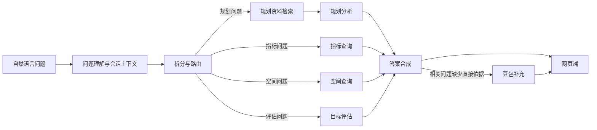

# 3820 战略知识助手

围绕福州“3820”战略工程的网页资料问答项目。用户可以用自然语言询问规划背景、三阶段目标、经济指标、空间布局和实施路径；系统优先从已收录资料与结构化数据作答，并在回答下方列出可追溯的来源。

开发者：**_serendipity**。使用中遇到问题，请联系 [serendipity_lin@sjtu.edu.cn](mailto:serendipity_lin@sjtu.edu.cn)。

## 项目能做什么

- **读懂战略**：查看“3820”背景长文、1990—2010 年时间线，询问规划形成过程与三年、八年、二十年阶段目标。
- **查询指标**：直接读取指南表 1 收录的 1990、1995、2000、2010 年 GDP、GNP、城乡收入、产业结构等 13 项指标。1995 年 GDP 阶段目标采用指南表 4 已列出的 204.80 亿元；原始扫描目标表另列 1995 年 GNP 目标 221 亿元，回答会说明两者是不同指标。不同统计版本的数值分别保留和标明来源。
- **分析空间与路径**：结合规划原件及整理资料，回答闽江口金三角经济圈、福州经济技术开发区、老市区、机场和“海上福州”等问题。
- **自然语言回答**：服务先理解同义问法、常见阶段问句笔误和同一会话最近几轮的追问，再由主智能体拆分问题，交给指标、规划、空间和评估模块处理，最后合成自然语言。单一事实问题简要回答；原因、过程、比较及复合问题在资料充足时展开背景、依据和联系。知识库没有直接匹配的材料时，可用用户配置的豆包模型补充；这类回答下方会以小字说明来源边界，不在回答正文展示检索失败提示。点击回答下方的本地来源，会进入与资料检索相同的阅读页；图片、视频、PDF 显示原件，文字资料显示可跳页的阅读稿，PPT 显示引用的幻灯片图像并可前后翻页；阅读页可下载对应原件。外部网页来源直接打开原网址。
- **在线语音对话**：点击聊天输入框旁的“语音对话”并允许麦克风权限。浏览器实时采集中文语音，服务端调用豆包流式语音识别 2.0 转成文字，再沿用同一套问答和资料检索流程；页面保留文字回答，同时调用豆包语音合成 2.0 播报。播报结束后继续聆听下一问，点击“结束语音”即可关闭。语音服务密钥只在服务器保存。
- **资料检索**：与问答并列的入口按标题和正文关键词查找文献、论文、PDF、图片和视频；图片使用 OCR 文字，视频使用语音转写及画面 OCR 文字。结果按相关度排序，可预览原图、播放原视频并下载。文字阅读稿支持关键词高亮和原始页码跳转，下载为 Word。最近 10 条检索词保存在当前浏览器。PPT 的逐页文字参与问答，但 PPT 和课程资料不在资料检索页公开。
- **保存对话**：当前浏览器保存最近 30 轮问答。每次打开默认进入新对话，旧对话可从侧边栏打开并直接看到最新回答；输入框始终位于聊天界面底部。

回答包含的历史数字应结合页面显示的指标名称、年份和统计版本理解。系统不会把 GDP 与 GNP、规划目标与后来完成值混为一项。

## 如何运行

需要 Python 3.11。克隆项目后，在项目根目录创建环境并安装依赖：

```bash
python3.11 -m venv .venv
.venv/bin/python -m pip install -r requirements.lock
cp .env.example .env
```

在本机 `.env` 中填写火山方舟控制台提供的 API Key 和已开通的模型 ID：

```dotenv
ARK_API_KEY=你的密钥
LLM_MODEL=你的对话模型ID
EMBED_MODEL=你的向量模型ID
```

`EMBED_MODEL` 仅在构建向量索引时使用。不要把真实密钥提交到 Git。

如已开通豆包语音合成 2.0 和流式语音识别 2.0，可在服务器 `.env` 中预先配置语音服务接口（模板见 `.env.example`）：

```dotenv
VOICE_API_KEY=你的语音服务API_Key
VOICE_ASR_WS_URL=wss://openspeech.bytedance.com/api/v3/sauc/bigmodel_async
VOICE_ASR_RESOURCE_ID=volc.seedasr.sauc.duration
VOICE_TTS_URL=https://openspeech.bytedance.com/api/v3/tts/unidirectional
VOICE_TTS_RESOURCE_ID=seed-tts-2.0
VOICE_TTS_SPEAKER=zh_female_vv_uranus_bigtts
```

这组配置与 `ARK_API_KEY` 分开。`VOICE_API_KEY` 必须是已获两项语音服务授权的 API Key；不要将其提交到 Git。未配置语音密钥时文字问答仍可运行。启动服务：

```bash
.venv/bin/python -m uvicorn app:app --host 127.0.0.1 --port 8000
```

浏览器打开 <http://127.0.0.1:8000/>。`GET /health` 可用于检查服务状态。若 `.env` 设置了 `SERVICE_API_KEY`，提问前还需在页面填写对应的网站访问密码。浏览器版的历史记录保存在当前浏览器的本地存储中。

语音对话需要浏览器授予麦克风权限，并支持 Web Audio 和 WebSocket。本机可在 `localhost` 或 `127.0.0.1` 使用；公网网页必须通过 **HTTPS** 访问，普通 HTTP 公网页面无法启用麦克风。服务器自身仍可使用 HTTP，由 Cloudflare 等 HTTPS 入口转发到现有服务。语音音频通过 `/voice/asr` 发送到服务器，再转给豆包语音识别；文字问题进入 `/chat`，回答经 `/voice/tts` 合成音频。语音接口与聊天接口使用同一网站访问密码。

现有服务器只有 HTTP 时，可在 Cloudflare 中将 `www` 域名记录设为代理状态，SSL/TLS 模式选 **Flexible**，启用 **Always Use HTTPS**，并确认 Network 中的 **WebSockets** 已启用；原来的 Uvicorn 端口和 HTTP 地址不必改，也不要让源站自行把 HTTP 重定向到 HTTPS。浏览器随后访问 `https://www.serendipity-lin.cn/`。这一步需要在域名的 Cloudflare 控制台完成；仅更新项目代码不会使现有 HTTP 站点自动获得 HTTPS。参见 [Cloudflare Flexible 模式](https://developers.cloudflare.com/ssl/origin-configuration/ssl-modes/flexible/) 与 [WebSockets 设置](https://developers.cloudflare.com/network/websockets/)。

要让资料检索显示完整结果，服务所在机器还需有 `knowledge/library/` 中的资料文件。原始压缩包在本机 `new_things/` 时，先安装 `requirements/ocr.txt` 和系统命令 `bsdtar`，再运行以下命令整理、按 SHA-256 去重，并生成 Markdown 对应的 Word 下载文件：

```bash
.venv/bin/python scripts/organize_library.py
.venv/bin/python -m scripts.import_supplemental_materials
```

分类后的 `knowledge/library/`、原件扫描与公开网页缓存已纳入 Git；PDF、PPT、图片、视频和 Word 等二进制资料由 Git LFS 管理。首次克隆前请安装 Git LFS，并执行 `git lfs install`；已克隆的工作区执行 `git lfs pull` 下载资料本体。`new_things/` 原始压缩包、`knowledge/data/` 中重复的原始 PPT/视频和 `var/` 运行数据仍不入 Git。资料目录、去重结果和访问范围见[资料清单](docs/资料清单.md)。

首次在资料齐全的本机建立图片、视频和 PPT 索引时，先安装可选依赖及 `ffmpeg`、`ffprobe`，再运行：

```bash
.venv/bin/python -m pip install -r requirements/multimedia.txt
.venv/bin/python scripts/index_multimedia.py --model base --frame-interval 30
```

这一步从 PPT 提取内嵌视频，生成 `knowledge/library/derived/` 中的 OCR、语音转写和逐页文字，并更新目录清单。视频首次转写需要本机可用的 faster-whisper `base` 模型；运行中的服务器只读取生成结果，不必安装这些转写依赖。资料更新提交并推送后，服务器执行 `git pull` 和 `git lfs pull` 即可取得新的目录与资料本体。语音和 OCR 可能有识别错误，回答应结合原件核对。

PPT 的可视化逐页预览在资料齐全的本机生成一次。安装 LibreOffice Impress 和构建用 Python 依赖后运行：

```bash
.venv/bin/python -m pip install -r requirements/ppt_preview.txt
.venv/bin/python scripts/render_ppt_previews.py
```

脚本把四份 PPT 转为 `knowledge/library/slide_previews/` 中的静态 WebP 图片，并在 `catalog.json` 记录页数。服务器只读取图片，不需要 LibreOffice 或 PyMuPDF；更新时将 `knowledge/library/` 整目录一起复制。幻灯片动画与内嵌视频不会在静态页面预览中播放，视频另以独立资料预览。

Windows PowerShell 的环境创建和启动命令分别使用 `py -3.11 -m venv .venv`、`.venv\Scripts\python.exe -m pip install -r requirements.lock` 和 `.venv\Scripts\python.exe -m uvicorn app:app --host 127.0.0.1 --port 8000`。

公网服务器部署时，先安装 Git LFS，再拉取代码和资料。服务器不需要 `new_things/` 原始压缩包、旧虚拟环境或本机 `var/` 运行数据。随后在服务器执行：

```bash
python3.11 -m venv .venv
.venv/bin/python -m pip install -r requirements.lock
git lfs install
git lfs pull
test -f .env || cp .env.example .env  # 首次部署后编辑豆包配置
.venv/bin/python -m uvicorn app:app --host 0.0.0.0 --port 8000
```

如要直接监听 80 端口，将最后一行的 `--port 8000` 改为 `--port 80`，并确保运行用户有绑定低端口的权限；也可在反向代理上把公网 80 端口转发到本机 8000。Docker 镜像默认仍只包含目录清单，需要把下载后的 `knowledge/library/` 和 `knowledge/data/` 挂载到容器中的同名路径。

## 实现方式



一次提问按以下步骤处理：

1. **理解、拆分与路由**：`knowledge/query_understanding.py` 将常见同义说法、阶段问句笔误和同一会话最近四轮的追问整理成独立问句；具名书籍、报告和采访的提问保留原题，避免误改写成“3820”背景问题。遇到规则无法识别的简短主题问法时，可用已配置的豆包模型从限定主题中分类，分类结果只用于选择资料，不充当事实依据。`agents/agent_main.py` 再将问题拆成规划、指标、空间、评估子任务并校验。`graph.py` 用 LangGraph 串联检索、执行和答案合成，并用 SQLite 保存可恢复的会话快照及最近问句。不同会话的上下文不混用。
2. **准备与检索资料**：`scripts/organize_library.py` 从最初的压缩包和既有资料生成分类目录；随后运行 `scripts/import_supplemental_materials.py` 把新上传的电子书逐页转写、去重并与原 PDF 配对。`scripts/index_multimedia.py` 为图片、视频和 PPT 生成带位置的提取文字。`knowledge/knowledge_base.py` 读取指南、文献、公开网页、图片 OCR、视频转写和 PPT 逐页文字，切成带原件文件名与页码或时间戳的片段。课程文档不进入问答；PPT 只进入问答。资料库目录存在时使用本地文本检索，避免继续使用旧向量索引。
3. **执行领域子任务**：指标模块从 `knowledge/indicators.json` 读取实际值，从指南表 4 和原件扫描目标表读取各自的规划目标；空间模块读取结构化空间资料；规划模块根据检索到的直接片段形成结构化报告；评估模块仅在比较年份、指标口径和判据足够明确时计算。不同来源的 GDP、GNP 或统计版本保留各自口径，不直接混算。
4. **合成与标注答案**：`agents/answer_writer.py` 汇总子任务结果和来源，优先生成有资料支撑的回答；具名文献问题按检索到的原文片段概括，引用对应书名与 PDF 页序号。仅当“3820”或福州发展相关问题缺少直接依据、且用户配置了对话模型时，才可能由豆包补充；这种回答标为模型参考内容，不伪造资料引用。依据不足或子任务失败会在结果中保留对应状态。

`app.py` 使用 FastAPI 提供静态页面、`/chat` 以及 `/library/search`、`/library/{id}/preview`、`/library/{id}/text`、`/library/{id}/download` 接口。`/sources/preview`、`/sources/text`、`/sources/open` 仅按目录清单中的引用路径预览和下载来源：公开资料和问答引用的 PPT 可访问，课程文件不可访问；PPT 仍不进入资料检索结果。对话历史保存在当前浏览器的本地存储中。

同义问法、连续追问和模糊检索的实际测试记录见[问答与资料检索审计](docs/project/检索与问答审计.md)。

| 路径 | 用途 |
| --- | --- |
| `app.py`、`web/` | 浏览器版服务与界面 |
| `graph.py`、`agents/` | 多智能体编排、领域处理和答案合成 |
| `knowledge/` | 资料解析、检索、指标和来源数据 |
| `knowledge/library/` | 分类后的资料本体与目录清单；二进制大文件使用 Git LFS |
| `new_things/` | 用户提供的原始压缩包；仅用于本机重建，不入 Git |
| `scripts/organize_library.py` | 解包、分类、去重并生成 Word 下载文件 |
| `scripts/import_supplemental_materials.py` | 增量导入新增电子书、逐页 OCR 并生成 PDF 对应的阅读稿和 Word |
| `docs/` | 原始指南、背景导读、资料清单与核对记录；`docs/project/` 保存项目过程文档 |
| `requirements/` | OCR 的可选依赖清单 |
| `tests/` | 离线功能、回答与界面检查 |

## 开发、测试与文档

本机离线测试：

```bash
.venv/bin/python -m pytest -m offline -q
```

问答质量还可用 `python -m scripts.evaluate_qa` 和 `python -m scripts.evaluate_expanded` 在已配置豆包模型的环境中复测。题目、检查范围与最近一次结果见[问答评测记录](docs/问答评测.md)。

完整搭建步骤与早期设计转写保存在 [INSTRUCTION.md](docs/project/INSTRUCTION.md)；原始指南在 [docs/基于3820战略工程内容的多智能体系统搭建指南.md](docs/基于3820战略工程内容的多智能体系统搭建指南.md)。资料索引见 [docs/资料清单.md](docs/资料清单.md)，原件与不同统计版本的记录见 [docs/原件核对.md](docs/原件核对.md)。
