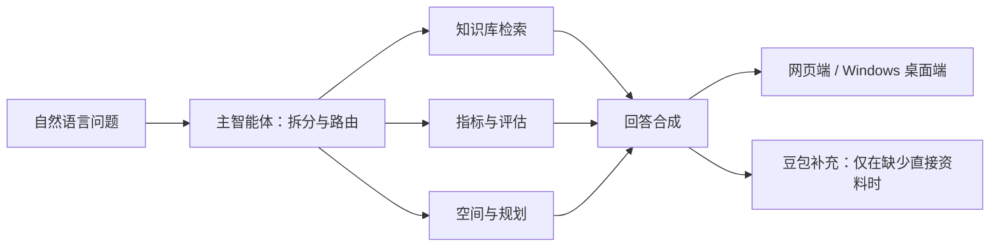

# 3820 战略知识助手

围绕福州“3820”战略工程的资料问答项目。用户可以用自然语言询问规划背景、三阶段目标、经济指标、空间布局和实施路径；系统优先从已收录资料与结构化数据作答，并在回答下方列出可追溯的来源。项目同时提供浏览器版和无需 WebView 的 Windows 原生桌面版。

开发者：**_serendipity**。使用中遇到问题，请联系 [serendipity_lin@sjtu.edu.cn](mailto:serendipity_lin@sjtu.edu.cn)。

## 项目能做什么

- **读懂战略**：查看“3820”背景长文、1990—2010 年时间线，询问规划形成过程与三年、八年、二十年阶段目标。
- **查询指标**：直接读取指南表 1 收录的 1990、1995、2000、2010 年 GDP、GNP、城乡收入、产业结构等 13 项指标。1995 年 GDP 阶段目标采用指南表 4 已列出的 204.80 亿元；原始扫描目标表另列 1995 年 GNP 目标 221 亿元，回答会说明两者是不同指标。不同统计版本的数值分别保留和标明来源。
- **分析空间与路径**：结合规划原件及整理资料，回答闽江口金三角经济圈、福州经济技术开发区、老市区、机场和“海上福州”等问题。
- **自然语言回答**：主智能体拆分问题，指标、规划、空间和评估模块分别处理，最后由回答模块合成自然语言。知识库没有直接匹配的材料时，可用用户配置的豆包模型补充；这类回答下方会以小字说明来源边界，不在回答正文展示检索失败提示。
- **保存对话**：网页端在当前浏览器保存最近 30 轮问答；桌面端在当前 Windows 用户的数据目录保存最近 30 轮。每次打开默认进入新对话，旧对话可从历史记录打开。

回答包含的历史数字应结合页面显示的指标名称、年份和统计版本理解。系统不会把 GDP 与 GNP、规划目标与后来完成值混为一项。

## 两个版本如何运行

### 1. 浏览器版

需要 Python 3.11。克隆项目后，在项目根目录创建环境并安装依赖：

```bash
python3.11 -m venv .venv
.venv/bin/python -m pip install -r requirements.lock
cp .env.example .env
```

在本机 `.env` 中填写火山方舟控制台提供的 API Key 和已开通的模型 ID：

```dotenv
ARK_API_KEY=你的密钥
LLM_MODEL=你的对话模型ID
EMBED_MODEL=你的向量模型ID
```

`EMBED_MODEL` 仅在构建向量索引时使用。不要把真实密钥提交到 Git。启动服务：

```bash
.venv/bin/python -m uvicorn app:app --host 127.0.0.1 --port 8000
```

浏览器打开 <http://127.0.0.1:8000/>。`GET /health` 可用于检查服务状态。若 `.env` 设置了 `SERVICE_API_KEY`，提问前还需在页面填写对应的网站访问密码。浏览器版的历史记录保存在当前浏览器的本地存储中。

Windows PowerShell 的环境创建和启动命令分别使用 `py -3.11 -m venv .venv`、`.venv\Scripts\python.exe -m pip install -r requirements.lock` 和 `.venv\Scripts\python.exe -m uvicorn app:app --host 127.0.0.1 --port 8000`。

### 2. Windows 桌面安装版

在 [Windows 安装包构建页面](https://github.com/serendipitylin0731/3820_agent/actions/workflows/windows-installer.yml) 打开最新成功运行记录，下载 `3820Agent-Windows-x64-Setup` 中的 `3820Agent-Setup-x64.exe`。运行安装器时可以选择 C 盘、D 盘或其他安装目录。Windows 10/11 x64 用户不需要单独安装 Python、WebView2，也不需要启动网页服务。

从开始菜单打开 **3820 战略知识助手**。首次启动会出现豆包 API 设置窗口：填写自己的 API Key 和已开通的对话模型 ID；向量模型 ID 可选。之后可从侧栏的 **豆包 API 设置** 修改。密钥通过 Windows DPAPI 加密后保存在当前用户的 `%APPDATA%\3820Agent\model_config.dpapi`，不会包含在安装包里。使用豆包回答时需要联网。

桌面版内置背景导读和结构化指标。要加入自己的 UTF-8 `.txt`、`.docx` 或 `.pptx`，点击 **导入资料**；文件会复制到 `%APPDATA%\3820Agent\knowledge\data`。桌面端历史记录在 `%APPDATA%\3820Agent\history.json`。项目仓库中未提交的大型原始文件不会自动包含在公开安装包内。

安装 0.7.0 或更新版后，窗口、任务栏、开始菜单和桌面快捷方式使用同一枚 Logo。若任务栏仍保留旧版固定图标，请先取消旧固定项，再从新安装的开始菜单快捷方式重新固定。

## 实现概览



后端使用 FastAPI 提供浏览器界面和问答接口；LangGraph 编排问题拆分、检索、专业模块和回答合成。常见规划问题优先匹配[背景导读](docs/3820背景.md)中经过整理、附有来源的主题章节；原件扫描和用户导入的 Word/PPT/文本仍供细节检索，避免 OCR 噪声盖过明确材料。无直接依据的问题可由豆包补充，回答下方说明来源边界。知识库可选用豆包向量模型建立本地向量索引。经济指标由 `knowledge/indicators.json` 提供，规划目标由指南表 4 与原件扫描目标表分别提供。桌面版使用 Tk 原生控件并直接调用同一问答图，不启动 HTTP 服务。

| 路径 | 用途 |
| --- | --- |
| `app.py`、`web/` | 浏览器版服务与界面 |
| `desktop.py`、`desktop_gui.py` | Windows 原生桌面入口与界面 |
| `graph.py`、`agents/` | 多智能体编排、领域处理和答案合成 |
| `knowledge/` | 资料解析、检索、指标和来源数据 |
| `docs/` | 原始指南、背景导读、资料清单与核对记录 |
| `packaging/` | Windows 可执行文件及安装器配置 |
| `tests/` | 离线功能、回答与界面检查 |

## 开发、测试与文档

本机离线测试：

```bash
.venv/bin/python -m pytest -m offline -q
```

问答质量还可用 `python -m scripts.evaluate_qa` 和 `python -m scripts.evaluate_expanded` 在已配置豆包模型的环境中复测。题目、检查范围与最近一次结果见[问答评测记录](docs/问答评测.md)。

Windows x64 维护者可以依次执行 `python -m pip install -r requirements-desktop.txt`、`python -m PyInstaller --noconfirm packaging/3820Agent.spec`，再用 Inno Setup 编译 `packaging/3820Agent.iss`。仓库的 Windows CI 会检查可执行文件、DPI 设置、安装后启动和快捷方式图标。

完整搭建步骤与早期设计转写保存在 [INSTRUCTION.md](INSTRUCTION.md)；原始指南在 [docs/基于3820战略工程内容的多智能体系统搭建指南.md](docs/基于3820战略工程内容的多智能体系统搭建指南.md)。资料索引见 [docs/资料清单.md](docs/资料清单.md)，原件与不同统计版本的记录见 [docs/原件核对.md](docs/原件核对.md)。
