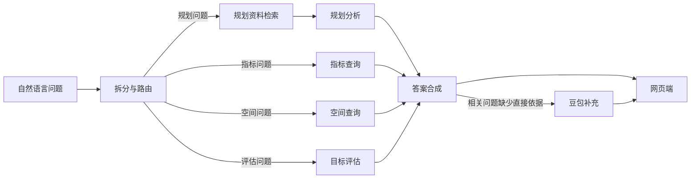

# 3820 战略知识助手

围绕福州“3820”战略工程的网页资料问答项目。用户可以用自然语言询问规划背景、三阶段目标、经济指标、空间布局和实施路径；系统优先从已收录资料与结构化数据作答，并在回答下方列出可追溯的来源。

开发者：**_serendipity**。使用中遇到问题，请联系 [serendipity_lin@sjtu.edu.cn](mailto:serendipity_lin@sjtu.edu.cn)。

## 项目能做什么

- **读懂战略**：查看“3820”背景长文、1990—2010 年时间线，询问规划形成过程与三年、八年、二十年阶段目标。
- **查询指标**：直接读取指南表 1 收录的 1990、1995、2000、2010 年 GDP、GNP、城乡收入、产业结构等 13 项指标。1995 年 GDP 阶段目标采用指南表 4 已列出的 204.80 亿元；原始扫描目标表另列 1995 年 GNP 目标 221 亿元，回答会说明两者是不同指标。不同统计版本的数值分别保留和标明来源。
- **分析空间与路径**：结合规划原件及整理资料，回答闽江口金三角经济圈、福州经济技术开发区、老市区、机场和“海上福州”等问题。
- **自然语言回答**：主智能体拆分问题，指标、规划、空间和评估模块分别处理，最后由回答模块合成自然语言。知识库没有直接匹配的材料时，可用用户配置的豆包模型补充；这类回答下方会以小字说明来源边界，不在回答正文展示检索失败提示。
- **资料检索**：与问答并列的入口按标题及正文关键词查找文字文档、本地论文、文献、PDF 和图片视频；结果可预览和下载。Markdown 在线预览，下载为 Word。PPT 和课程资料只归档，不在检索结果和聊天知识库中出现。
- **保存对话**：当前浏览器保存最近 30 轮问答。每次打开默认进入新对话，旧对话可从历史记录打开。

回答包含的历史数字应结合页面显示的指标名称、年份和统计版本理解。系统不会把 GDP 与 GNP、规划目标与后来完成值混为一项。

## 如何运行

需要 Python 3.11。克隆项目后，在项目根目录创建环境并安装依赖：

```bash
python3.11 -m venv .venv
.venv/bin/python -m pip install -r requirements.lock
cp .env.example .env
```

在本机 `.env` 中填写火山方舟控制台提供的 API Key 和已开通的模型 ID：

```dotenv
ARK_API_KEY=你的密钥
LLM_MODEL=你的对话模型ID
EMBED_MODEL=你的向量模型ID
```

`EMBED_MODEL` 仅在构建向量索引时使用。不要把真实密钥提交到 Git。启动服务：

```bash
.venv/bin/python -m uvicorn app:app --host 127.0.0.1 --port 8000
```

浏览器打开 <http://127.0.0.1:8000/>。`GET /health` 可用于检查服务状态。若 `.env` 设置了 `SERVICE_API_KEY`，提问前还需在页面填写对应的网站访问密码。浏览器版的历史记录保存在当前浏览器的本地存储中。

要让资料检索显示完整结果，服务所在机器还需有 `knowledge/library/` 中的资料文件。原始压缩包在本机 `new_things/` 时，运行以下命令整理、按 SHA-256 去重，并生成 Markdown 对应的 Word 下载文件：

```bash
.venv/bin/python scripts/organize_library.py
```

`knowledge/library/catalog.json` 随代码提交，约 1.4 GiB 的资料正文和影像、`new_things/` 原始压缩包、`knowledge/data/` 中的 OCR/网页抓取缓存均不入 Git。**仅拉取代码无法在服务器上预览或下载这些资料**；部署时需另外把本机的 `knowledge/library/` 整目录复制到服务器项目同名路径。聊天还使用 `knowledge/data/public_sources/` 和 `knowledge/data/original_3820/` 的文字缓存，也应一并复制。复制后重启服务即可读取新清单。目录分类、去重结果和访问范围见[资料清单](docs/资料清单.md)。

Windows PowerShell 的环境创建和启动命令分别使用 `py -3.11 -m venv .venv`、`.venv\Scripts\python.exe -m pip install -r requirements.lock` 和 `.venv\Scripts\python.exe -m uvicorn app:app --host 127.0.0.1 --port 8000`。

公网服务器部署时先更新代码，并将本机 `knowledge/library/`、`knowledge/data/public_sources/`、`knowledge/data/original_3820/` 复制到服务器项目中的同名位置。服务器只需要当前项目代码和这些资料目录；`new_things/` 压缩包、`.venv/`、`var/`、旧桌面安装文件都不需要上传。随后在服务器执行：

```bash
python3.11 -m venv .venv
.venv/bin/python -m pip install -r requirements.lock
test -f .env || cp .env.example .env  # 首次部署后编辑豆包配置
.venv/bin/python -m uvicorn app:app --host 0.0.0.0 --port 8000
```

如要直接监听 80 端口，将最后一行的 `--port 8000` 改为 `--port 80`，并确保运行用户有绑定低端口的权限；也可在反向代理上把公网 80 端口转发到本机 8000。Docker 镜像仅包含目录清单，需要把 `knowledge/library/` 和 `knowledge/data/` 挂载到容器中的同名路径。

## 实现方式



一次提问按以下步骤处理：

1. **拆分与路由**：`agents/agent_main.py` 将问题拆成规划、指标、空间、评估子任务，并用数据契约校验。配置了豆包对话模型时可由模型辅助拆分；未配置或模型输出无效时使用本地规则。`graph.py` 用 LangGraph 串联拆分、按需检索、子任务执行和答案合成，并用 SQLite 保存可恢复的会话快照。
2. **准备与检索资料**：`scripts/organize_library.py` 从本地压缩包和既有资料生成分类目录及去重清单。`knowledge/knowledge_base.py` 读取指南、允许检索的 Markdown、公开网页文字和原件扫描 OCR，切成带来源的片段；PPT 与课程资料不进入聊天检索。资料库目录存在时使用本地文本检索，避免继续使用此前可能包含课程 PPT 的旧向量索引。
3. **执行领域子任务**：指标模块从 `knowledge/indicators.json` 读取实际值，从指南表 4 和原件扫描目标表读取各自的规划目标；空间模块读取结构化空间资料；规划模块根据检索到的直接片段形成结构化报告；评估模块仅在比较年份、指标口径和判据足够明确时计算。不同来源的 GDP、GNP 或统计版本保留各自口径，不直接混算。
4. **合成与标注答案**：`agents/answer_writer.py` 汇总子任务结果和来源，优先生成有资料支撑的回答。仅当“3820”或福州发展相关问题缺少直接依据、且用户配置了对话模型时，才可能由豆包补充；这种回答标为模型参考内容，不伪造资料引用。依据不足或子任务失败会在结果中保留对应状态。

`app.py` 使用 FastAPI 提供静态页面、`/chat` 以及 `/library/search`、`/library/{id}/preview`、`/library/{id}/download` 接口。服务端只允许清单中标记公开的文件访问，不能通过修改前端请求取出 PPT 或课程资料。对话历史保存在当前浏览器的本地存储中。

| 路径 | 用途 |
| --- | --- |
| `app.py`、`web/` | 浏览器版服务与界面 |
| `graph.py`、`agents/` | 多智能体编排、领域处理和答案合成 |
| `knowledge/` | 资料解析、检索、指标和来源数据 |
| `knowledge/library/` | 分类后的资料本体与目录清单；大文件不入 Git |
| `new_things/` | 用户提供的原始压缩包；仅用于本机重建，不入 Git |
| `scripts/organize_library.py` | 解包、分类、去重并生成 Word 下载文件 |
| `docs/` | 原始指南、背景导读、资料清单与核对记录；`docs/project/` 保存项目过程文档 |
| `requirements/` | OCR 的可选依赖清单 |
| `tests/` | 离线功能、回答与界面检查 |

## 开发、测试与文档

本机离线测试：

```bash
.venv/bin/python -m pytest -m offline -q
```

问答质量还可用 `python -m scripts.evaluate_qa` 和 `python -m scripts.evaluate_expanded` 在已配置豆包模型的环境中复测。题目、检查范围与最近一次结果见[问答评测记录](docs/问答评测.md)。

完整搭建步骤与早期设计转写保存在 [INSTRUCTION.md](docs/project/INSTRUCTION.md)；原始指南在 [docs/基于3820战略工程内容的多智能体系统搭建指南.md](docs/基于3820战略工程内容的多智能体系统搭建指南.md)。资料索引见 [docs/资料清单.md](docs/资料清单.md)，原件与不同统计版本的记录见 [docs/原件核对.md](docs/原件核对.md)。
