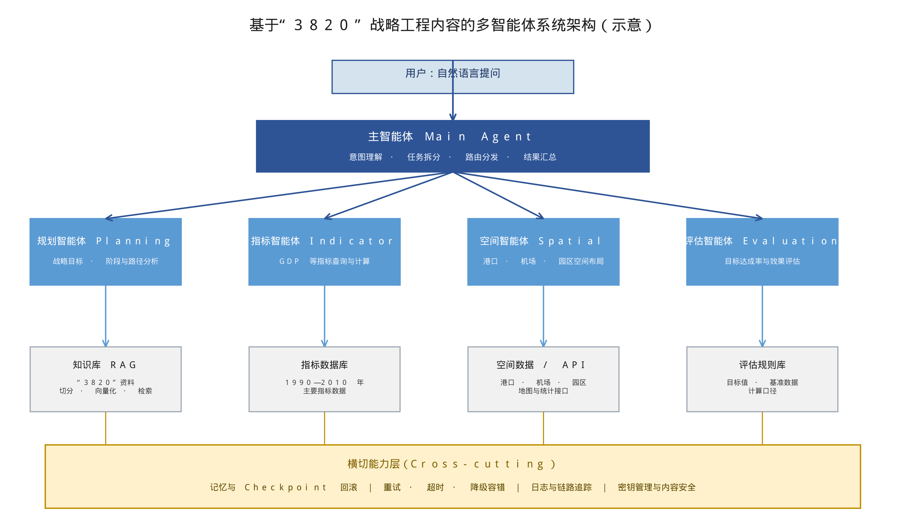

# 基于“3820”战略工程内容的多智能体系统搭建指南

> 本文件保存此前 README 的详细搭建步骤及原指南转写。当前项目概览与网页服务运行方式以 [README.md](../../README.md) 为准。

<a id="current-implementation"></a>

## 当前实现与运行（2026-10-11）

本节说明仓库中**已经实现的程序**。下方保留原指南的完整转写，供核对需求和设计；其中的代码片段是原指南示例，实际运行以本节和仓库文件为准。

### 第一步：准备 Python 与依赖

在项目根目录使用 Python 3.11 创建环境并安装已锁定的依赖：

```bash
python3.11 -m venv .venv
.venv/bin/python -m pip install -r requirements.lock
```

当前机器已有 `.venv` 时直接使用即可。`requirements.txt` 是宽松版本说明，可复现运行请使用 `requirements.lock`。

### 第二步：配置豆包 API

复制样例并编辑本机 `.env`：

```bash
cp .env.example .env
```

至少填写以下三项，其中 API Key 从火山方舟控制台获取，模型 ID 必须是当前账号已开通的 ID。本机已验证过的示例是：

```dotenv
ARK_API_KEY=在本机填写实际密钥
LLM_MODEL=doubao-seed-character-260628
EMBED_MODEL=doubao-embedding-vision-251215
```

不要把真实密钥写进 README 或提交 `.env`。未配置模型时，服务仍可离线启动，但只能使用规则拆分、现有文本检索和模板回答；模型补充功能需要 `ARK_API_KEY` 与 `LLM_MODEL`。网站访问密码 `SERVICE_API_KEY` 是可选项，与豆包密钥不是同一个值。

### 第三步：准备知识库

程序读取原指南、`knowledge/data/` 中的 Word/PPT、已提取的 PPT 图片文字、公开资料文字、原件扫描 OCR，以及结构化指标数据。当前工作区已有资料和向量索引；**新克隆的仓库只有 `knowledge/data/.gitkeep`**，需要把有权使用的原始资料重新放入 `knowledge/data/`。资料清单与来源定位见 [资料清单](../资料清单.md) 和 [原件核对](../原件核对.md)。

需要重建向量索引时，先确认 `.env` 中的 `EMBED_MODEL`，再执行：

```bash
.venv/bin/python -m knowledge.knowledge_base
```

索引保存在 `var/knowledge_index/`，不提交到 Git。`.env.example` 中的 `VECTOR_MAX_DISTANCE=1.2` 只是本机当前资料与模型的演示校准值；更换资料或向量模型后应重新校准。新增公开网页和原件扫描的提取命令、PPT 图片 OCR 步骤见 [TASK.md](TASK.md)。视频转写目前没有可靠覆盖。

### 第四步：启动和提问

```bash
.venv/bin/python -m uvicorn app:app --host 127.0.0.1 --port 8000
```

打开 <http://127.0.0.1:8000/>。页面默认进入新的空白对话，左侧展示最近 30 轮本机浏览器历史记录，时间轴收起；点击“3820 背景”后，主区域显示完整导读，侧栏只显示时间轴。返回问答即可重新查看历史记录，旧对话仍可手动打开。页面提供随机示例问题，直接输入自然语言问题即可。服务不提供 `/docs`、`/redoc` 页面，也不在界面展示内部分析过程。可用 `GET /health` 检查服务；如设置了 `SERVICE_API_KEY`，问答时按页面提示填写网站访问密码。

回答优先使用本地资料并列出可点击的来源。长乐国际机场与对外开放的问题可定位到原件扫描预览第 255 页；访谈的问句和相邻答复会一起用于回答。GDP/GNP、三次产业占比等指标走结构化数据，2010 年 GDP 异值保留两个版本，不直接跨口径计算增长率。若规划类问题缺少直接依据，只对“3820”及福州发展相关问题调用已配置的豆包模型补充；回答会明确标成**豆包模型参考回答**，该路径没有网页检索来源。缺少目标达成判据或问题与主题无关时仍说明依据不足。

### 第五步：验证和排查

```bash
.venv/bin/python -m pytest -m offline -q
.venv/bin/python -m scripts.evaluate_qa
.venv/bin/python -m scripts.evaluate_expanded
```

第一项不需要在线服务；后两项会实际调用豆包与向量服务，要求本机资料、索引和密钥可用。扩展题集包含页面示例和补充问题，完整问答记录写入 Git 忽略的 `var/qa_expanded_report.json`。评测结果见 [问答评测](../问答评测.md)；接口与模型补充行为见 [DESIGN.md](DESIGN.md)，实施和部署流程见 [TASK.md](TASK.md)。原件档案身份、全部指标的原始口径、复杂图片 OCR、2000/2010 年定性目标判据及生产部署仍需进一步核验。

---

> 内容来源：“3820”战略工程资料

<details open>
<summary><strong>目 录</strong></summary>

<ul>
  <li><a href="#sec-1">1 概述</a>
    <details>
      <summary>展开下级目录</summary>
      <ul>
        <li><a href="#sec-1-1">1.1 项目背景与目标</a>
        </li>
        <li><a href="#sec-1-2">1.2 “3820”战略工程内容概览（依据附件资料）</a>
          <details>
            <summary>展开下级目录</summary>
            <ul>
              <li><a href="#sec-1-2-1">1.2.1 三阶段目标</a>
              </li>
              <li><a href="#sec-1-2-2">1.2.2 制定过程</a>
              </li>
              <li><a href="#sec-1-2-3">1.2.3 实施路径</a>
              </li>
              <li><a href="#sec-1-2-4">1.2.4 主要成效与数据</a>
              </li>
            </ul>
          </details>
        </li>
        <li><a href="#sec-1-3">1.3 智能体系统总体定位</a>
        </li>
        <li><a href="#sec-1-4">1.4 阅读对象与使用方式</a>
        </li>
      </ul>
    </details>
  </li>
  <li><a href="#sec-2">2 领域知识建模：把“3820”内容转化为机器可用知识</a>
    <details>
      <summary>展开下级目录</summary>
      <ul>
        <li><a href="#sec-2-1">2.1 核心知识实体与关系</a>
        </li>
        <li><a href="#sec-2-2">2.2 指标知识体系</a>
        </li>
        <li><a href="#sec-2-3">2.3 空间要素体系</a>
        </li>
        <li><a href="#sec-2-4">2.4 战略—路径—效果因果链</a>
        </li>
      </ul>
    </details>
  </li>
  <li><a href="#sec-3">3 总体架构设计</a>
    <details>
      <summary>展开下级目录</summary>
      <ul>
        <li><a href="#sec-3-1">3.1 多智能体架构总览</a>
        </li>
        <li><a href="#sec-3-2">3.2 主智能体</a>
        </li>
        <li><a href="#sec-3-3">3.3 规划智能体</a>
        </li>
        <li><a href="#sec-3-4">3.4 指标智能体</a>
        </li>
        <li><a href="#sec-3-5">3.5 空间智能体</a>
        </li>
        <li><a href="#sec-3-6">3.6 评估智能体</a>
        </li>
        <li><a href="#sec-3-7">3.7 架构按需增删建议</a>
        </li>
      </ul>
    </details>
  </li>
  <li><a href="#sec-4">4 技术选型与框架</a>
    <details>
      <summary>展开下级目录</summary>
      <ul>
        <li><a href="#sec-4-1">4.1 智能体框架选型</a>
        </li>
        <li><a href="#sec-4-2">4.2 大模型API接入（火山方舟·豆包）</a>
        </li>
        <li><a href="#sec-4-3">4.3 知识库与向量检索选型</a>
        </li>
        <li><a href="#sec-4-4">4.4 运行环境与依赖</a>
        </li>
      </ul>
    </details>
  </li>
  <li><a href="#sec-5">5 分步实施：从代码层面搭建</a>
    <details>
      <summary>展开下级目录</summary>
      <ul>
        <li><a href="#sec-5-1">5.1 项目结构与初始化</a>
        </li>
        <li><a href="#sec-5-2">5.2 知识库构建（RAG）</a>
        </li>
        <li><a href="#sec-5-3">5.3 主智能体实现（任务拆分与汇总）</a>
        </li>
        <li><a href="#sec-5-4">5.4 规划智能体实现</a>
        </li>
        <li><a href="#sec-5-5">5.5 指标智能体实现</a>
        </li>
        <li><a href="#sec-5-6">5.6 空间智能体实现</a>
        </li>
        <li><a href="#sec-5-7">5.7 评估智能体实现</a>
        </li>
        <li><a href="#sec-5-8">5.8 LangGraph编排与条件路由</a>
        </li>
        <li><a href="#sec-5-9">5.9 FastAPI对外服务封装</a>
        </li>
      </ul>
    </details>
  </li>
  <li><a href="#sec-6">6 知识库检索Skill连接</a>
    <details>
      <summary>展开下级目录</summary>
      <ul>
        <li><a href="#sec-6-1">6.1 自建RAG检索模块接入</a>
        </li>
        <li><a href="#sec-6-2">6.2 对接既有检索技能</a>
        </li>
        <li><a href="#sec-6-3">6.3 工具注册与调用协议</a>
        </li>
      </ul>
    </details>
  </li>
  <li><a href="#sec-7">7 出错回滚与容错机制</a>
    <details>
      <summary>展开下级目录</summary>
      <ul>
        <li><a href="#sec-7-1">7.1 错误分类与重试策略</a>
        </li>
        <li><a href="#sec-7-2">7.2 超时与降级</a>
        </li>
        <li><a href="#sec-7-3">7.3 状态Checkpoint与回滚</a>
        </li>
        <li><a href="#sec-7-4">7.4 幂等与补偿</a>
        </li>
        <li><a href="#sec-7-5">7.5 日志与链路追踪</a>
        </li>
      </ul>
    </details>
  </li>
  <li><a href="#sec-8">8 测试、评估与监控</a>
    <details>
      <summary>展开下级目录</summary>
      <ul>
        <li><a href="#sec-8-1">8.1 单元测试与集成测试</a>
        </li>
        <li><a href="#sec-8-2">8.2 效果评估方法</a>
        </li>
        <li><a href="#sec-8-3">8.3 可观测性</a>
        </li>
      </ul>
    </details>
  </li>
  <li><a href="#sec-9">9 部署与运维</a>
    <details>
      <summary>展开下级目录</summary>
      <ul>
        <li><a href="#sec-9-1">9.1 部署方案</a>
        </li>
        <li><a href="#sec-9-2">9.2 配置与密钥管理</a>
        </li>
        <li><a href="#sec-9-3">9.3 上线检查清单</a>
        </li>
      </ul>
    </details>
  </li>
  <li><a href="#sec-10">10 附录</a>
    <details>
      <summary>展开下级目录</summary>
      <ul>
        <li><a href="#appendix-a">附录A 项目结构说明</a>
        </li>
        <li><a href="#appendix-b">附录B 依赖清单</a>
        </li>
        <li><a href="#appendix-c">附录C 指标数据示例（指标智能体内置数据）</a>
        </li>
        <li><a href="#appendix-d">附录D 参考资料</a>
        </li>
      </ul>
    </details>
  </li>
</ul>

</details>

<a id="sec-1"></a>

# 1 概述

<a id="sec-1-1"></a>

## 1.1 项目背景与目标

“3820”战略工程（《福州市20年经济社会发展战略设想》）以3年、8年、20年三个时间跨度设定发展目标，围绕经济、社会、空间、民生等多个维度展开，是我国地方中长期战略规划的典型案例。以该工程内容为知识导向搭建多智能体系统，可以把历史战略文本、指标数据、空间要素和效果评估转化为可查询、可分析、可推演的智能服务，服务于战略研究、政策分析和学习教育等场景。

本项目标为交付一套以“3820”工程内容为导向的多智能体系统：由主智能体负责理解用户问题、拆分任务并汇总答案；规划智能体负责战略规划与路径分析；指标智能体负责GDP等经济指标查询与计算；空间智能体负责港口、园区等空间布局分析；评估智能体负责评估实际效果与目标达成率。五个角色可以按实际需求增删，各智能体共享同一个知识库与检索通道。

本指南提供从零搭建的实施示例，覆盖大模型API调用、Agent框架选型、知识库检索、容错与部署。示例代码仍需根据实际模型权限、依赖版本、环境变量和数据文件进行配置，并通过测试后方可用于生产环境。

<a id="sec-1-2"></a>

## 1.2 “3820”战略工程内容概览（依据附件资料）

<a id="sec-1-2-1"></a>

### 1.2.1 三阶段目标

“3820”的三层含义：用3年时间（到1995年）使福州经济上一个大台阶，主要指标在1990年基础上再翻一番，提前实现小康水平；力争用8年时间（到2000年），使全市城乡各项人均水平等主要指标达到国内先进城市的发展水平；用20年时间（到2010年），达到或接近亚洲中等发达国家或地区当时的平均发展水平。

<a id="sec-1-2-2"></a>

### 1.2.2 制定过程

1992年前后，福州开展了“万人问卷、千人调研、百人论证”工作，围绕581个课题、由1600多名干部展开调研；在《福州晚报》刊发调查问卷征求市民建议，半个月即收到2.5万多条意见。历时半年、十易其稿，1992年11月，《福州市20年经济社会发展战略设想》在福州市委六届六次全会上审议通过。

<a id="sec-1-2-3"></a>

### 1.2.3 实施路径

主要技术路线有四条：以侨引侨，蹚出对外开放新路；园区为基，引领工业立市方向；深化改革，开创集中审批先河；拓新改旧，助推城市更新升级。实施过程中也面对侨商投资吸引、基础设施短板（如当时没有民用机场）、投资软环境顾虑等挑战，并通过完善硬件设施、优化服务机制（如“一栋楼办公”“马上就办”）等方式应对。

<a id="sec-1-2-4"></a>

### 1.2.4 主要成效与数据

经济方面，按本指南采用的指标数据口径，全市地区生产总值从1990年的102.4亿元增长到2010年的3123.41亿元；城镇化率提高近39个百分点。城镇居民人均可支配收入从1992年的2273元增长到2023年的58009元，农村居民人均可支配收入从1992年的1109元增长到2023年的28636元。社会与科技方面，福州成为全国9个垃圾分类免检城市之一，苍霞片区由1983年的棚户区改造为2017年的新城，发展新型材料、人工智能等战略性新兴产业并形成纺织化纤、电子信息等千亿产业集群，涌现13兆瓦海上风电电机等成果。

从规划内容看，“3820”工程体现了以民生为核心、以人为本、生态环境改善、文化与教育普及、人民参与治理、可持续发展等主题，这些主题可作为规划智能体的分析维度。

<a id="sec-1-3"></a>

## 1.3 智能体系统总体定位

系统定位为“3820知识助手与战略推演平台”，面向研究者、政策分析者和学习者，提供四类核心能力：一是知识问答，基于“3820”资料库回答工程背景、目标、路径与成效问题；二是指标查询，提供GDP、人均收入等指标的多年份查询与计算；三是空间分析，梳理港口、机场、园区、城市更新等空间要素；四是效果评估，对照阶段目标计算目标达成率并给出结论。

<a id="sec-1-4"></a>

## 1.4 阅读对象与使用方式

本指南适合具有Python基础的开发者阅读。建议按第5章顺序实施：先构建知识库，再实现各智能体，然后接入LangGraph编排，最后封装对外服务；第6至第9章分别说明检索Skill连接、容错回滚、测试评估与部署运维。文中所有示例代码可以在工程目录中逐步复制运行。

<a id="sec-2"></a>

# 2 领域知识建模：把“3820”内容转化为机器可用知识

<a id="sec-2-1"></a>

## 2.1 核心知识实体与关系

搭建智能体之前，需要先把“3820”工程内容建模为结构化知识。建议建立五类知识实体：阶段目标（3年、8年、20年三个阶段的定性目标）、指标体系（GDP、人均GDP、城乡收入等）、空间要素（港口、机场、园区、侨商网络、城市更新片区）、实施路径（以侨引侨、园区为基、深化改革、拓新改旧）、效果评估（目标值与实际值的对照）。

实体之间的核心关系包括：阶段目标约束指标体系（如1995年主要指标较1990年翻一番）；实施路径承载于空间要素（如“园区为基”对应各类开发区和投资区）；效果评估将阶段目标与实际数据对照，形成“目标—实际—达成率”的计算链。这些实体和关系可直接设计为知识库的文档切片、表格字段与JSON结构。

<a id="sec-2-2"></a>

## 2.2 指标知识体系

依据附件资料中《福州市“3820战略工程”目标主要指标完成情况》表，本指南当前整理出13项主要指标在1990年、1995年、2000年、2010年四个年份的数值，作为指标智能体的内置基准数据（表1）。这些数据同时用于评估智能体的达成率计算；上线前应与原始资料逐项核验。

**表1 “3820”战略工程主要指标完成情况（来自附件资料）**

| **指标**                    | **单位** | **1990年** | **1995年** | **2000年** | **2010年** |
|-----------------------------|----------|------------|------------|------------|------------|
| 地区收入总值（GNP）         | 亿元     | 110.91     | 495.55     | 925.35     | 3165.05    |
| 人均收入总值（人均GNP）     | 元       | 2097       | 8776       | 15670      | 45262      |
| 地区生产总值（GDP）         | 亿元     | 102.40     | 464.14     | 876.39     | 3123.41    |
| 第一产业占比                | %        | 28.72      | 21.23      | 15.42      | 9.05       |
| 第二产业占比                | %        | 40.25      | 36.02      | 43.23      | 44.88      |
| 第三产业占比                | %        | 31.03      | 42.75      | 41.34      | 46.06      |
| 人均地区生产总值（人均GDP） | 元       | 1936       | 8219       | 14841      | 44000      |
| 工农业总产值                | 亿元     | 179.76     | 666.28     | 1341.27    | 5349.07    |
| 农业总产值                  | 亿元     | 42.48      | 159.46     | 217.42     | 480.01     |
| 工业总产值                  | 亿元     | 137.28     | 506.82     | 1123.85    | 4869.05    |
| 出口总值                    | 亿美元   | 2.34       | 15.67      | 27.29      | 163.14     |
| 城镇居民人均可支配收入      | 元       | 1537       | 4896       | 7944       | 22723      |
| 农村居民人均纯收入          | 元       | 864        | 2303       | 3860       | 8543       |

指标智能体应同时记录指标名称、单位、统计年份、统计口径、原始来源位置、数据版本和核验状态，以便在回答中标注来源并追溯差异。不同统计口径或不可直接比较的指标，不应自动计算增长率或据此作结论。

若不同章节或来源出现冲突（例如历史GDP数值），系统应标记冲突并要求核验；本修订版统一采用本指南确认的2010年GDP 3123.41亿元，不应再混用其他数值。

<a id="sec-2-3"></a>

## 2.3 空间要素体系

从附件资料可以归纳以下空间要素类别：对外通道（港口、民用机场，其中1990年代初福州尚缺民用机场，属于基础设施补短板重点）；园区载体（“园区为基”路径下的开发区、投资区，如元洪投资区）；城市更新片区（如苍霞片区，1983年棚户区到2017年新城）；开放交流空间（如海上丝绸之路博览会等展会与商贸载体）；侨商网络（福州作为侨乡，400多万侨胞遍布世界各地，是以侨引侨的空间纽带）。

空间智能体可维护一张空间要素表，字段建议包括：要素名称、要素类型（港口/机场/园区/城市更新/展会）、所属时期、关联实施路径、关联指标（如投资额、产值）、数据来源。要素坐标与地图展示可后续对接地图类API实现，本指南不涉及地图组件。

<a id="sec-2-4"></a>

## 2.4 战略—路径—效果因果链

建议在知识库中保存一条完整的因果链：调研论证（万人问卷、千人调研、百人论证，581个课题，2.5万多条市民意见）→ 战略设想形成（1992年11月审议通过）→ 三阶段目标分解 → 四条实施路径落地 → 成效数据产出。评估智能体以这条链为分析框架，把“目标设定—执行举措—实际成效”串起来回答“目标完成得怎么样、为什么”。

<a id="sec-3"></a>

# 3 总体架构设计

<a id="sec-3-1"></a>

## 3.1 多智能体架构总览

系统采用“一个总控、四个专业、一组支撑、一层横切”的分层架构（图1）：主智能体负责意图理解、任务拆分、路由分发与结果汇总；规划、指标、空间、评估四个专业智能体承接对应子任务。当前示例代码中的多类型任务按顺序执行；如需并行，需另行实现并测试并发调度、共享状态合并和部分失败处理。支撑层提供知识库RAG检索、指标数据库、空间数据与API、评估规则库；横切能力层提供Checkpoint、重试与降级、日志与链路追踪、密钥管理与内容安全等能力。



*图1 基于“3820”战略工程内容的多智能体系统架构（示意）*

<a id="sec-3-2"></a>

## 3.2 主智能体

主智能体是整个系统的总控：一是意图理解，判断用户问题属于知识问答、指标查询、空间分析还是效果评估，或者混合类型；二是任务拆分，把复杂问题拆为带类型标记的子任务，输出结构化JSON；三是路由分发，依据子任务类型调用对应的专业智能体；四是结果汇总，将各专业智能体的输出组织成统一答案，并保留数据来源标注。

<a id="sec-3-3"></a>

## 3.3 规划智能体

规划智能体负责战略规划类分析，围绕“3820”内容回答“为什么这样规划、分哪几个阶段、采取了什么路径、效果如何”等结构化问题。输出建议包含背景、阶段目标、路径举措、关键依据、风险与建议等小节，并引用知识库片段作为依据。

<a id="sec-3-4"></a>

## 3.4 指标智能体

指标智能体负责GDP、人均GDP、GNP、三次产业占比、城乡收入等指标的查询与计算，支持按年份取值、多年份对比、增长率与结构占比计算，并在回答中注明数据口径与来源。

<a id="sec-3-5"></a>

## 3.5 空间智能体

空间智能体负责港口、机场、园区、城市更新等空间要素的查询与分析，可回答“1990年代福州交通基础设施的短板”“元洪投资区在对外开放中的作用”“苍霞片区城市更新历程”等问题，输出要素清单与空间布局分析。

<a id="sec-3-6"></a>

## 3.6 评估智能体

评估智能体将实际数据与阶段目标对照。对上升型且目标值为正的指标，可用实际值÷目标值×100%；对下降型指标，应先明确目标是否为上限，并采用单独规则，避免实际值为0时除零。区间型目标和定性目标应采用预先定义的判定规则；“达到国内先进城市水平”“接近亚洲中等发达国家水平”等目标，需明确比较对象、年份、指标口径及“接近”的标准后再评估。

<a id="sec-3-7"></a>

## 3.7 架构按需增删建议

上述架构是参考基线，可按实际场景增删：需要统一入口检索时可增加“检索智能体”；需要图表输出时可增加“可视化智能体”；需要跨会话记忆时可增加“记忆智能体”；任务规模较小时可将规划与评估合并为一个“分析智能体”，或直接由主智能体直答简单问题而不拆分。表2给出各智能体的职责与工具清单，可作为验收基线。

**表2 智能体职责与工具清单**

| **智能体** | **核心职责**                   | **主要工具与数据**             | **输出形态**         |
|------------|--------------------------------|--------------------------------|----------------------|
| 主智能体   | 意图理解、任务拆分、路由、汇总 | 大模型、工具注册表、状态编排   | 子任务JSON与最终答案 |
| 规划智能体 | 战略目标、阶段与路径分析       | 知识库RAG、规划分析提示词      | 结构化分析片段       |
| 指标智能体 | 指标查询与计算                 | 指标数据库（内置表或外部API）  | 数值结果与口径说明   |
| 空间智能体 | 空间要素查询与布局分析         | 空间数据表、地图类API（可选）  | 要素清单与分析结论   |
| 评估智能体 | 目标达成率与效果评估           | 评估规则库（目标值、基准数据） | 达成率与评估结论     |

<a id="sec-4"></a>

# 4 技术选型与框架

<a id="sec-4-1"></a>

## 4.1 智能体框架选型

当前主流的多智能体实现方式包括图编排框架、对话式协作框架、角色化任务框架和低代码平台四类（表3）。本项目推荐LangGraph：它是面向Agent编排的低层级框架，以有向图描述节点与条件边，提供状态管理与Checkpoint接口（持久化需配置具体Saver），对“主智能体拆分任务→专业智能体执行→汇总”的编排者（orchestrator-worker）模式有原生支持，适合对流程可控性、可回滚要求高的生产系统。

**表3 多智能体框架对比与选型建议**

| **框架**         | **类型**   | **主要特点**                                          | **适用场景**                 | **选型建议** |
|------------------|------------|-------------------------------------------------------|------------------------------|--------------|
| LangGraph        | 图编排框架 | 有向图+状态机、Checkpoint持久化、编排者模式、Send并行 | 流程可控、需要回滚的生产系统 | 推荐         |
| AutoGen          | 对话式协作 | 会话式多智能体协作、代码执行                          | 研究原型、多角色对话         | 可选         |
| CrewAI           | 角色化任务 | 角色/任务/流程抽象、上手快                            | 简单任务流水线               | 可选         |
| MetaGPT          | SOP驱动    | 软件公司式分工、标准作业流程                          | 软件开发类多智能体场景       | 参考         |
| Dify等低代码平台 | 可视化平台 | 拖拽编排、内置RAG与工具                               | 非深度定制场景               | 参考         |

本指南后续代码以LangGraph为主框架；若改用其他框架，第5章中的智能体函数（输入输出均为普通Python对象）可以原样复用，只需替换编排层。

<a id="sec-4-2"></a>

## 4.2 大模型API接入（火山方舟·豆包）

大模型调用采用火山方舟平台的豆包系列模型，其服务兼容OpenAI SDK，base地址为https://ark.cn-beijing.volces.com/api/v3（以官方文档为准）。模型ID以方舟控制台实际开通为准，示例中使用doubao-seed-2-1-pro-260628。接入代码如下：

```python
# llm_client.py —— 大模型客户端（火山方舟·豆包）
import os
from dotenv import load_dotenv
from openai import OpenAI
load_dotenv()
BASE_URL = 'https://ark.cn-beijing.volces.com/api/v3'
LLM_MODEL = os.getenv('LLM_MODEL', 'doubao-seed-2-1-pro-260628')  # 以控制台实际开通的模型ID为准
client = OpenAI(
    base_url=BASE_URL,
api_key=os.getenv('ARK_API_KEY') or (_ for _ in ()).throw(RuntimeError('请先配置ARK_API_KEY')),
)
def chat(messages, temperature=0.3):
    resp = client.chat.completions.create(
        model=LLM_MODEL,
        messages=messages,
        temperature=temperature,
    )
    return resp.choices[0].message.content
```

> **说明：**也可以使用官方SDK（pip install `volcengine-python-sdk[ark]`）以Ark客户端调用；两种方式均需先在火山方舟控制台创建API Key并开通相应模型。

<a id="sec-4-3"></a>

## 4.3 知识库与向量检索选型

知识库采用RAG（检索增强生成）方案：先将“3820”资料切分为片段，调用文本向量化API生成向量并入库，回答时检索最相关的片段作为上下文。文本向量化采用火山方舟的Doubao-embedding模型（接口为/api/v3/embeddings，示例模型ID为doubao-embedding-large-text-240915，以控制台为准）。向量库可选FAISS（本地轻量，适合起步）、Chroma（带持久化与元数据过滤）、Qdrant或Milvus（适合规模化生产），本指南示例使用FAISS。

<a id="sec-4-4"></a>

## 4.4 运行环境与依赖

建议开发和部署统一使用经过验证的Python版本（本指南示例以Python 3.11为基线）；主要依赖包括langgraph、openai、faiss-cpu、numpy、tenacity、fastapi、uvicorn、python-dotenv、python-pptx和pydantic。附录B中的版本下限仅用于说明依赖范围，不等同于可复现的锁定环境；上线前应生成并测试锁定依赖文件。

<a id="sec-5"></a>

# 5 分步实施：从代码层面搭建

<a id="sec-5-1"></a>

## 5.1 项目结构与初始化

建议采用如下目录结构，将原始资料放入knowledge/data目录。实际项目还应增加`agents/__init__.py`与`knowledge/__init__.py`（或明确采用命名空间包），并在README中固定启动目录和环境配置方式：

```text
3820-agent/
├── app.py                  # FastAPI 对外服务
├── graph.py                # LangGraph 编排（状态图+条件路由+Checkpoint）
├── resilience.py           # 重试、降级、回滚
├── agents/
│   ├── agent_main.py       # 主智能体：任务拆分与汇总
│   ├── agent_planning.py   # 规划智能体
│   ├── agent_indicator.py  # 指标智能体
│   ├── agent_spatial.py    # 空间智能体
│   └── agent_evaluation.py # 评估智能体
├── knowledge/
│   ├── knowledge_base.py   # 知识库：切分/向量化/检索
│   └── data/3820视频.pptx   # 领域原始资料
├── tools/tools.py          # 工具函数注册
├── tests/                  # 单元测试
├── requirements.txt
├── .env.example            # 环境变量样例
└── README.md
```

先创建虚拟环境并安装依赖，再准备环境变量文件：

```bash
python -m venv .venv
source .venv/bin/activate        # Windows: .venv\Scripts\activate
pip install -r requirements.txt  # 依赖清单见附录B
cp .env.example .env             # 填入真实的ARK_API_KEY
```

.env.example内容如下，API密钥只从环境变量读取，不写入代码：

```dotenv
# .env.example
ARK_API_KEY=您的API_KEY
LLM_MODEL=doubao-seed-2-1-pro-260628
EMBED_MODEL=doubao-embedding-large-text-240915
PPT_PATH=knowledge/data/3820视频.pptx
```

<a id="sec-5-2"></a>

## 5.2 知识库构建（RAG）

知识库模块负责读取“3820”演示文稿文本与表格、切分片段、调用向量化API并实现检索。图片型图表、扫描页和复杂图示不保证能由python-pptx提取，必要时需另加OCR或人工结构化录入。示例使用FAISS建库：

```python
# knowledge/knowledge_base.py
import os
import numpy as np
import faiss
from openai import OpenAI
from pptx import Presentation
from dotenv import load_dotenv
from functools import lru_cache
load_dotenv()
BASE_URL = 'https://ark.cn-beijing.volces.com/api/v3'
EMBED_MODEL = 'doubao-embedding-large-text-240915'   # 以控制台为准
client = OpenAI(base_url=BASE_URL, api_key=os.environ['ARK_API_KEY'])
def load_ppt_text(path):
    # 按页读取演示文稿文本，每页作为一个知识片段
    prs = Presentation(path)
    chunks = []
    for idx, slide in enumerate(prs.slides, start=1):
        texts = []
        for shape in slide.shapes:
            if getattr(shape, 'has_text_frame', False):
                text = shape.text_frame.text.strip()
                if text:
                    texts.append(text)
            elif getattr(shape, 'has_table', False):
                for row in shape.table.rows:
                    cells = [cell.text.strip() for cell in row.cells]
                    if any(cells):
                        texts.append(' | '.join(cells))
        if texts:
            chunks.append(f'[第{idx}页] ' + ' '.join(texts))
    return chunks
def embed_texts(texts):
    resp = client.embeddings.create(model=EMBED_MODEL, input=texts)
    return [item.embedding for item in resp.data]
def build_index(chunks):
    if not chunks:
        raise ValueError('知识库没有可索引的文本片段')
    vectors = np.asarray(embed_texts(chunks), dtype='float32')
    if vectors.ndim != 2 or vectors.shape[0] != len(chunks):
        raise ValueError('向量数量或维度与知识片段不一致')
    index = faiss.IndexFlatL2(vectors.shape[1])
    index.add(vectors)
    return index
def retrieve(index, chunks, query, top_k=5):
    # 返回[(片段, L2距离)]；距离仅表示向量距离，不代表事实可靠性
    if index is None or not chunks or index.ntotal == 0 or top_k <= 0:
        return []
    top_k = min(top_k, index.ntotal, len(chunks))
    qv = np.asarray(embed_texts([query]), dtype='float32')
    distances, ids = index.search(qv, top_k)
    return [(chunks[i], float(distances[0][j])) for j, i in enumerate(ids[0]) if 0 <= i < len(chunks)]
@lru_cache(maxsize=1)
def get_knowledge_base():
    path = os.getenv('PPT_PATH')
    if not path:
        raise RuntimeError('请配置PPT_PATH')
    chunks = load_ppt_text(path)
    return chunks, build_index(chunks)
def retrieve_context(query, top_k=5):
    chunks, index = get_knowledge_base()
    hits = retrieve(index, chunks, query, top_k)
    if not hits:
        return '知识库暂无相关依据。'
    return '\n\n'.join(piece for piece, _distance in hits)
if __name__ == '__main__':
    chunks = load_ppt_text(os.environ['PPT_PATH'])
    index = build_index(chunks)
    for piece, dist in retrieve(index, chunks, '1995年GDP翻一番目标'):
        print(dist, piece[:60])
```

<a id="sec-5-3"></a>

## 5.3 主智能体实现（任务拆分与汇总）

主智能体把用户问题拆分为带类型标记的子任务。每个子任务至少包含type和question；指标任务应尽量提供key与years，空间任务应提供keyword及可选stype。所有字段须校验后再路由，避免缺失参数被静默替换为默认值：

```python
# agents/agent_main.py
import json
import os
from llm_client import chat, client
SPLIT_SYSTEM = '''
你是“3820”战略工程知识系统的总控智能体。
请把用户问题拆分为若干子任务，子任务类型只能从以下四类中选择：
- planning：战略规划与路径分析
- indicator：经济指标查询与计算
- spatial：空间布局（港口、园区、城市更新等）分析
- evaluation：目标达成率与效果评估
每个子任务至少包含type与question两个字段；indicator任务还应尽可能提供key（指标键）与years（年份数组），spatial任务应提供keyword及可选stype。只输出合法JSON数组。
注意：必须输出合法JSON，不要添加Markdown代码围栏；字符串键和值使用英文双引号。
示例：[ {"type":"indicator","question":"2010年福州GDP是多少？","key":"gdp","years":[2010]},
{"type":"evaluation","question":"1995年翻一番目标完成情况如何？"} ]
'''
def split_task(question):
    resp = client.chat.completions.create(
        model=os.environ.get('LLM_MODEL', 'doubao-seed-2-1-pro-260628'),
        messages=[
            {'role': 'system', 'content': SPLIT_SYSTEM},
            {'role': 'user', 'content': question},
        ],
        temperature=0,
    )
    return json.loads(resp.choices[0].message.content)
def summarize(question, results):
    # 将各专业智能体结果汇总为最终答案（示例为结构化拼接）
    parts = [f'问题：{question}']
    for key, value in results.items():
        parts.append(f'[{key}结果] {value}')
    return '\n'.join(parts)
```

<a id="sec-5-4"></a>

## 5.4 规划智能体实现

规划智能体以结构化提示词驱动，结合知识库检索片段输出阶段与路径分析：

```python
# agents/agent_planning.py
PLANNING_SYSTEM = '''
你是“3820”战略工程的规划分析智能体。
请结合知识库中的“3820”内容（三阶段目标、制定过程、四条实施路径、人民情怀主题），
对用户提出的战略规划类问题进行结构化分析，输出建议包含：
背景、阶段目标、路径举措、关键依据、风险与建议。
所有关键依据必须来自提供的参考资料片段。
'''
def run_planning(question, kb_text):
    from llm_client import client
    import os
    resp = client.chat.completions.create(
        model=os.environ.get('LLM_MODEL', 'doubao-seed-2-1-pro-260628'),
        messages=[
            {'role': 'system', 'content': PLANNING_SYSTEM},
        {'role': 'user', 'content': '问题：{}\n参考资料：{}'.format(question, kb_text or '无')},
        ],
    )
    return resp.choices[0].message.content
```

> **注意：**参考资料应来自实际检索结果；未检索到充分证据时，应明确标注“知识库暂无相关依据”，不得编造。检索结果应保留来源页码或片段ID。

<a id="sec-5-5"></a>

## 5.5 指标智能体实现

指标智能体以内置指标数据为主，数值与表1一致（完整JSON见附录C）。查询函数返回指标名称、单位与年份取值，便于后续计算与展示：

```python
# agents/agent_indicator.py
INDICATOR_DATA = {
    'gdp': {'name': '地区生产总值（GDP）', 'unit': '亿元', 'values': {1990: 102.40, 1995: 464.14, 2000: 876.39, 2010: 3123.41}},
    'gdp_per_capita': {'name': '人均地区生产总值', 'unit': '元', 'values': {1990: 1936, 1995: 8219, 2000: 14841, 2010: 44000}},
    'gnp': {'name': '地区收入总值（GNP）', 'unit': '亿元', 'values': {1990: 110.91, 1995: 495.55, 2000: 925.35, 2010: 3165.05}},
    'gnp_per_capita': {'name': '人均收入总值（人均GNP）', 'unit': '元', 'values': {1990: 2097, 1995: 8776, 2000: 15670, 2010: 45262}},
    'industry_primary': {'name': '第一产业占比', 'unit': '%', 'values': {1990: 28.72, 1995: 21.23, 2000: 15.42, 2010: 9.05}},
    'industry_secondary': {'name': '第二产业占比', 'unit': '%', 'values': {1990: 40.25, 1995: 36.02, 2000: 43.23, 2010: 44.88}},
    'industry_tertiary': {'name': '第三产业占比', 'unit': '%', 'values': {1990: 31.03, 1995: 42.75, 2000: 41.34, 2010: 46.06}},
    'gross_ia': {'name': '工农业总产值', 'unit': '亿元', 'values': {1990: 179.76, 1995: 666.28, 2000: 1341.27, 2010: 5349.07}},
    'agriculture_output': {'name': '农业总产值', 'unit': '亿元', 'values': {1990: 42.48, 1995: 159.46, 2000: 217.42, 2010: 480.01}},
    'industry_output': {'name': '工业总产值', 'unit': '亿元', 'values': {1990: 137.28, 1995: 506.82, 2000: 1123.85, 2010: 4869.05}},
    'export_total': {'name': '出口总值', 'unit': '亿美元', 'values': {1990: 2.34, 1995: 15.67, 2000: 27.29, 2010: 163.14}},
    'urban_income': {'name': '城镇居民人均可支配收入', 'unit': '元', 'values': {1990: 1537, 1995: 4896, 2000: 7944, 2010: 22723}},
    'rural_income': {'name': '农村居民人均纯收入', 'unit': '元', 'values': {1990: 864, 1995: 2303, 2000: 3860, 2010: 8543}},
}
def query_indicator(key, years=None):
    # 按指标键与年份查询；未收录的指标返回错误信息
    info = INDICATOR_DATA.get(key)
    if info is None:
        return {'error': f'未找到指标 {key}，可查：{list(INDICATOR_DATA)}'}
    years = sorted(info['values']) if years is None else years
    missing_years = [year for year in years if year not in info['values']]
    if missing_years:
        return {'error': '未收录年份{}，可查年份：{}'.format(missing_years, sorted(info['values']))}
    return {
        'name': info['name'],
        'unit': info['unit'],
        'values': {y: info['values'][y] for y in years if y in info['values']},
        'source': '附件资料《主要指标完成情况》表',
    }
```

若需对接外部统计API，应先核对指标口径与年份，再查询并缓存结果；本地与外部数据冲突时不得静默覆盖，应返回来源、版本和冲突提示。

<a id="sec-5-6"></a>

## 5.6 空间智能体实现

空间智能体维护一张空间要素表（内容来自附件资料），提供按类型和关键词的查询，并为后续对接地图类API预留接口：

```python
# agents/agent_spatial.py
SPATIAL_DATA = [
    {'name': '港口与对外通道', 'type': '对外通道',
     'note': '客商进出与物资集散通道；1990年代初民用机场缺失属于基础设施短板'},
    {'name': '民用机场', 'type': '基础设施',
     'note': '当时福州没有民用机场，客商进不来、物资出不去，是建设重点'},
    {'name': '开发区与园区', 'type': '园区载体',
     'note': '“园区为基”的工业立市路径载体'},
    {'name': '元洪投资区', 'type': '园区',
     'note': '附件资料图示的对外投资区代表，与以侨引侨相关'},
    {'name': '苍霞片区', 'type': '城市更新',
     'note': '1983年棚户区，2017年改造为新城，体现拓新改旧'},
    {'name': '海上丝绸之路博览会', 'type': '开放交流空间',
     'note': '对外开放与经贸交流载体'},
]
def query_spatial(keyword=None, stype=None):
    result = [
        item for item in SPATIAL_DATA
        if (keyword is None or keyword in item['name'] or keyword in item['note'])
        and (stype is None or item['type'] == stype),
    ]
    return result if result else {'error': '知识库暂无匹配的空间要素'}
# 对接地图类API时，在返回结果中追加坐标字段即可，不改变接口形态
```

<a id="sec-5-7"></a>

## 5.7 评估智能体实现

评估智能体实现目标达成率计算。上升型指标、下降型指标和区间型指标应使用各自明确的规则。下例仅演示“目标为基准值翻一番”的上升型指标，实际使用时还需校验目标值、实际值及指标口径：

```python
# agents/agent_evaluation.py
def compute_achievement(actual, target, direction='up'):
    # down表示目标为上限：实际值不高于目标即视为达标（100%）
    if actual is None or target is None or direction not in ('up', 'down'):
        return None
    if direction == 'up':
        if target <= 0:
            return None
        ratio = actual / target
    else:
        if actual < 0 or target < 0:
            return None
        ratio = 1.0 if actual <= target else (target / actual if actual else 1.0)
    return round(ratio * 100, 1)
def eval_1995_phase(data):
    # 以附件数据核算：3年目标=1990年指标*2，计算1995年达成率
    rows = []
    for key in ('gnp', 'gdp', 'gdp_per_capita', 'urban_income', 'rural_income', 'industry_output'):
        info = data[key]
        base = info['values'][1990]
        actual = info['values'][1995]
        target = round(base * 2, 2)
        rows.append({
            '指标': info['name'], '单位': info['unit'],
            '基准': base, '目标': target, '实际': actual,
            '达成率': compute_achievement(actual, target),
        })
    return rows
```

**表4 1995年阶段目标达成率示例（目标=1990年指标翻一番，按附件数据计算）**

| **指标**               | **单位** | **1990年基准** | **翻番目标** | **1995年实际** | **达成率** |
|------------------------|----------|----------------|--------------|----------------|------------|
| 地区生产总值（GDP）    | 亿元     | 102.40         | 204.80       | 464.14         | 226.6%     |
| 人均地区生产总值       | 元       | 1936           | 3872         | 8219           | 212.3%     |
| 地区收入总值（GNP）    | 亿元     | 110.91         | 221.82       | 495.55         | 223.4%     |
| 城镇居民人均可支配收入 | 元       | 1537           | 3074         | 4896           | 159.3%     |
| 农村居民人均纯收入     | 元       | 864            | 1728         | 2303           | 133.3%     |
| 工业总产值             | 亿元     | 137.28         | 274.56       | 506.82         | 184.6%     |

表4的计算口径为：达成率=1995年实际值÷（1990年基准×2）×100%，四舍五入保留1位小数；例如GDP达成率=464.14÷204.80×100%=226.6%。本示例只评估可量化的“翻一番”目标。2000年和2010年的定性目标不能仅替换一个基准值就直接套用同一公式，必须先定义可核验的比较对象、年份、指标口径和达标判据。

<a id="sec-5-8"></a>

## 5.8 LangGraph编排与条件路由

编排层把“主智能体拆分→检索上下文→条件路由→专业智能体执行→汇总”组织为状态图。示例使用内存Checkpoint；内存状态在进程退出后会丢失，生产环境必须配置并验证持久化存储：

```python
# graph.py —— LangGraph 编排（orchestrator-worker 模式）
from typing import TypedDict
from langgraph.graph import StateGraph, START, END
from langgraph.checkpoint.memory import MemorySaver
from agents.agent_main import split_task, summarize
from agents.agent_planning import run_planning
from agents.agent_indicator import query_indicator, INDICATOR_DATA
from agents.agent_spatial import query_spatial
from agents.agent_evaluation import eval_1995_phase
from knowledge.knowledge_base import retrieve_context
class TaskState(TypedDict):
    question: str        # 用户问题
    sub_tasks: list      # 主智能体拆分结果
    kb_context: str      # 知识库检索上下文
    results: dict        # 各智能体结果
    answer: str          # 最终答案
def parse_node(state):
    tasks = split_task(state['question'])
    if not tasks:
        raise ValueError('主智能体未生成有效子任务')
    for task in tasks:
        if task.get('type') not in ('planning', 'indicator', 'spatial', 'evaluation'):
            raise ValueError('子任务type不在允许范围内')
        if task.get('type') == 'indicator' and not task.get('key'):
            raise ValueError('指标子任务缺少key字段')
        if task.get('type') == 'spatial' and not task.get('keyword'):
            raise ValueError('空间子任务缺少keyword字段')
    needs_context = any(t.get('type') in ('planning', 'spatial', 'evaluation') for t in tasks)
    kb_context = retrieve_context(state['question']) if needs_context else ''
    return {'sub_tasks': tasks, 'kb_context': kb_context}
def route_node(state):
    # 根据子任务类型决定下一节点
    if len(state['sub_tasks']) == 1:
        task_type = state['sub_tasks'][0]['type']
        return {'planning': 'planning_node', 'indicator': 'indicator_node',
                'spatial': 'spatial_node', 'evaluation': 'evaluation_node'}[task_type]
    return 'parallel_node'
def planning_node(state):
    task = state['sub_tasks'][0]
    return {'results': {'planning': run_planning(task['question'], state['kb_context'])}}
def indicator_node(state):
    task = state['sub_tasks'][0]
    key = task.get('key', 'gdp')
    years = task.get('years')
    return {'results': {'indicator': query_indicator(key, years)}}
def spatial_node(state):
    task = state['sub_tasks'][0]
    return {'results': {'spatial': query_spatial(task.get('keyword'), task.get('stype'))}}
def evaluation_node(state):
    # 该节点目前仅演示固定的1995年翻番评估，其他阶段需显式传入目标规则
    return {'results': {'evaluation': eval_1995_phase(INDICATOR_DATA)}}
def parallel_node(state):
    # 多类型子任务按序执行；真正并行需另行实现并测试
    results = {}
    for i, task in enumerate(state['sub_tasks'], start=1):
        t = task['type']
        if t == 'planning':
            results[f'{t}_{i}'] = run_planning(task['question'], state['kb_context'])
        elif t == 'indicator':
            results[f'{t}_{i}'] = query_indicator(task.get('key', 'gdp'), task.get('years'))
        elif t == 'spatial':
            results[f'{t}_{i}'] = query_spatial(task.get('keyword'), task.get('stype'))
        elif t == 'evaluation':
            results[f'{t}_{i}'] = eval_1995_phase(INDICATOR_DATA)
    return {'results': results}
def answer_node(state):
    return {'answer': summarize(state['question'], state['results'])}
builder = StateGraph(TaskState)
builder.add_node('parse_node', parse_node)
builder.add_node('planning_node', planning_node)
builder.add_node('indicator_node', indicator_node)
builder.add_node('spatial_node', spatial_node)
builder.add_node('evaluation_node', evaluation_node)
builder.add_node('parallel_node', parallel_node)
builder.add_node('answer_node', answer_node)
builder.add_edge(START, 'parse_node')
builder.add_conditional_edges('parse_node', route_node, {
    'planning_node': 'planning_node',
    'indicator_node': 'indicator_node',
    'spatial_node': 'spatial_node',
    'evaluation_node': 'evaluation_node',
    'parallel_node': 'parallel_node',
})
for node in ('planning_node', 'indicator_node', 'spatial_node', 'evaluation_node', 'parallel_node'):
    builder.add_edge(node, 'answer_node')
builder.add_edge('answer_node', END)
checkpointer = MemorySaver()   # 内存Checkpoint；生产建议 SqliteSaver 持久化
app = builder.compile(checkpointer=checkpointer)
def ask(question, thread_id):
    config = {'configurable': {'thread_id': thread_id}}
    return app.invoke({
        'question': question,
        'sub_tasks': [],
        'kb_context': '',
        'results': {},
    }, config)
```

> **说明：**此示例中的多类型任务仍按顺序执行，不应描述为已经并行。当前示例通过检索函数在需要时生成上下文；如需真正并行，应使用适配当前LangGraph版本的Send/worker模式，并测试共享状态合并、重复任务和部分失败处理。

<a id="sec-5-9"></a>

## 5.9 FastAPI对外服务封装

对外提供HTTP接口，统一返回request_id、答案与各智能体结果，便于排查与追踪：

```python
# app.py —— FastAPI 对外服务
import uuid
import logging
from fastapi import FastAPI, HTTPException
from pydantic import BaseModel
from graph import ask
app = FastAPI(title='3820多智能体系统')
class ChatRequest(BaseModel):
    question: str
    thread_id: str | None = None
class ChatResponse(BaseModel):
    request_id: str
    answer: str
    results: dict
@app.post('/chat', response_model=ChatResponse)
def chat(req: ChatRequest):
    request_id = str(uuid.uuid4())
    try:
        result = ask(req.question, thread_id=req.thread_id or request_id)
        return ChatResponse(
            request_id=request_id,
            answer=result.get('answer', ''),
            results=result.get('results', {}),
        )
    except Exception as exc:
     logging.exception('处理/chat请求失败 request_id=%s', request_id)
     raise HTTPException(status_code=500, detail={'request_id': request_id, 'error': '服务暂时不可用，请稍后重试'})
```

生产环境还需配置认证、授权、速率限制和请求体大小限制；当前示例未包含这些中间件，不应直接暴露到公网。

<a id="sec-6"></a>

# 6 知识库检索Skill连接

<a id="sec-6-1"></a>

## 6.1 自建RAG检索模块接入

知识库检索函数应输入查询文本并返回相关片段及来源元数据。当前示例仅按向量距离返回top_k结果，尚未实现经测试集校准的相关性阈值；上线前必须验证检索效果并加入距离过滤，未达到阈值时返回“知识库暂无充分依据”。

<a id="sec-6-2"></a>

## 6.2 对接既有检索技能

如果运行环境中已有企业知识检索或平台级检索能力（例如豆包工作模式下的企业知识检索、飞书知识库检索、企业搜索API等），可以将其封装为同一形态的检索函数：输入query，返回结构化片段列表（含正文与来源）。封装后替换knowledge_base中retrieve的内部实现即可，编排层与各智能体代码无需改动，从而实现“检索Skill连接”。

<a id="sec-6-3"></a>

## 6.3 工具注册与调用协议

为了让大模型在函数调用（function calling）模式下自主选择工具，需要为每个工具注册OpenAI风格的schema，并实现统一的call_tool分发函数：

```python
# tools/tools.py —— 工具注册与统一调用
from knowledge.knowledge_base import retrieve_context
from agents.agent_indicator import query_indicator
from agents.agent_spatial import query_spatial
TOOL_SCHEMA = [
    {
        'type': 'function',
        'function': {
            'name': 'knowledge_retrieve',
            'description': '检索“3820”战略工程知识库（目标、路径、成效等事实）',
            'parameters': {
                'type': 'object',
                'properties': {'query': {'type': 'string', 'description': '检索问题或关键词'}},
                'required': ['query'],
            },
        },
    },
    {
        'type': 'function',
        'function': {
            'name': 'query_indicator',
            'description': '查询主要经济指标（GDP、人均GDP、GNP、城乡收入等）',
            'parameters': {
                'type': 'object',
                'properties': {
                    'key': {'type': 'string'},
                    'years': {'type': 'array', 'items': {'type': 'integer'}},
                },
                'required': ['key'],
            },
        },
    },
  {
     'type': 'function',
     'function': {
        'name': 'query_spatial',
        'description': '按关键词与类型查询空间要素',
        'parameters': {
           'type': 'object',
           'properties': {'keyword': {'type': 'string'}, 'stype': {'type': 'string'}},
           'required': ['keyword'],
        },
     },
  },
]
def call_tool(name, arguments):
    # 工具分发：知识检索、指标查询与空间查询均走此入口
    if name == 'knowledge_retrieve':
        return retrieve_context(arguments['query'])
    if name == 'query_indicator':
        return query_indicator(arguments['key'], arguments.get('years'))
    if name == 'query_spatial':
        return query_spatial(arguments.get('keyword'), arguments.get('stype'))
    raise ValueError(f'未知工具：{name}')
# 大模型请求示例：messages + tools=TOOL_SCHEMA，模型返回 tool_calls 后
# 循环调用 call_tool，把工具结果回填 messages 后继续对话（function calling 标准流程）
```

<a id="sec-7"></a>

# 7 出错回滚与容错机制

<a id="sec-7-1"></a>

## 7.1 错误分类与重试策略

建议按错误来源与可重试性分类处理（表5）。原则是：瞬时错误（超时、限流、连接中断）退避重试；确定性错误（参数校验失败、数据缺失）不盲目重试而是修复或降级；节点异常回滚到最近Checkpoint。

**表5 错误分类与处理策略**

| **错误类型**      | **典型表现**            | **处理策略**               | **回退或降级**         |
|-------------------|-------------------------|----------------------------|------------------------|
| 模型API超时或限流 | HTTP 429、5xx、连接超时 | 指数退避重试3次            | 备用模型或提示稍后重试 |
| 知识库检索失败    | 向量库不可用、空结果    | 重试1次，清空检索上下文    | 无检索直接生成并注明   |
| 工具调用参数错误  | schema校验失败          | 自动修复参数后重试1次      | 跳过该工具并提示用户   |
| 编排节点异常      | 单个节点抛出异常        | 捕获并回滚至最近Checkpoint | 返回已完成的子结果     |
| 服务进程崩溃      | 进程退出或重启          | 自动重启并恢复持久化状态   | 从未完成步骤续跑       |

<a id="sec-7-2"></a>

## 7.2 超时与降级

用tenacity实现带退避的重试，并设计降级路径：模型不可用时返回明确提示或使用备用模型；检索不可用时跳过检索直接生成（答案标注“未引用知识库”）：

```python
# resilience.py —— 重试、超时与降级
import os
from tenacity import retry, stop_after_attempt, wait_exponential, retry_if_exception_type
class ModelAPIError(Exception):
    # 模型调用异常（超时、限流、5xx等）
    pass
@retry(stop=stop_after_attempt(3),
       wait=wait_exponential(multiplier=1, max=8),
       retry=retry_if_exception_type((ModelAPIError, TimeoutError)),
       reraise=True)
def call_llm_safe(client, model, messages, timeout=30):
    try:
        resp = client.chat.completions.create(
            model=model, messages=messages, timeout=timeout,
        )
        return resp.choices[0].message.content
    except Exception as exc:
        # 仅对超时、限流和服务端瞬时错误重试；认证或参数错误不重试。
        if isinstance(exc, TimeoutError) or getattr(exc, 'status_code', None) in (429, 500, 502, 503, 504):
            raise ModelAPIError(str(exc)) from exc
        raise
def call_with_fallback(client, model, messages, backup_model=None):
    # 重试失败后的降级：备用模型或明确提示
    try:
        return call_llm_safe(client, model, messages)
    except ModelAPIError:
        if backup_model:
            return call_llm_safe(client, backup_model, messages)
        return '【降级】模型服务暂不可用，请稍后重试。'
```

<a id="sec-7-3"></a>

## 7.3 状态Checkpoint与回滚

LangGraph可通过Checkpoint保存图状态；MemorySaver只适合开发和测试，不能在进程重启后恢复状态。生产环境应配置持久化Saver，并按已安装版本文档实现检查点定位与恢复；不能假定metadata中一定存在名为step的字段。

```python
# resilience.py 续：基于LangGraph Checkpoint的状态回滚
def find_checkpoint(app, thread_id, checkpoint_id):
    # 先定位历史快照；具体恢复/续跑接口应按安装的LangGraph版本实现
    config = {'configurable': {'thread_id': thread_id}}
    for checkpoint in app.get_state_history(config):
        current_id = checkpoint.config.get('configurable', {}).get('checkpoint_id')
        if current_id == checkpoint_id:
            return checkpoint
    return None
            return checkpoint
    return None
# 使用示例：先通过find_checkpoint定位目标快照，再按当前LangGraph版本文档调用恢复/续跑接口。
# checkpoint = rollback_to(app, thread_id='t001', step=1)
```

> **说明：**该示例仅定位历史快照，不等同于自动回滚或恢复执行。真正恢复时，应使用该快照的config及当前LangGraph版本支持的接口，并明确从哪个节点继续。

<a id="sec-7-4"></a>

## 7.4 幂等与补偿

对外服务可使用request_id实现请求幂等与结果缓存；thread_id应按会话或用户隔离，不应让所有用户共用固定的default线程。若后续增加写入类操作，应采用先查后写、幂等键和补偿日志。

<a id="sec-7-5"></a>

## 7.5 日志与链路追踪

全链路贯穿request_id与thread_id，日志采用结构化JSON输出，方便按请求检索错误链路：

```python
# resilience.py 续：结构化日志
import json
import logging
logger = logging.getLogger('3820_agent')
def log_event(event, request_id, thread_id, level='info', **extra):
    record = {
        'event': event,
        'request_id': request_id,
        'thread_id': thread_id,
        'level': level,
        **extra,
    }
    getattr(logger, level)(json.dumps(record, ensure_ascii=False))
```

<a id="sec-8"></a>

# 8 测试、评估与监控

<a id="sec-8-1"></a>

## 8.1 单元测试与集成测试

建议为达成率计算、知识库检索等纯函数编写单元测试，为整图编排编写集成测试。测试需覆盖边界值、空知识库、无效年份、单类型和混合任务、模型超时、检索无命中及进程重启；测试结果应与独立核验的期望值逐项比较：

```python
# tests/test_evaluation.py
def test_gdp_1995_achievement():
    # 1990年GDP 102.40亿元，翻番目标204.80亿元，1995年实际464.14亿元
    from agent_evaluation import compute_achievement
    assert compute_achievement(464.14, 204.80) == 226.6
def test_ratio_direction():
    from agent_evaluation import compute_achievement
    assert compute_achievement(80, 100, direction='down') == 100.0
def test_kb_retrieve():
    from knowledge_base import retrieve, chunks, index
    hits = retrieve(index, chunks, '1995年翻一番目标')
    assert len(hits) >= 1
# 运行：pytest tests/ -v
```

集成测试至少覆盖：单一类型问题（如“2010年福州GDP是多少”）、混合类型问题、无知识库依据的问题、未知指标/年份、空索引、检索低相关、单个子任务失败及重复请求。无依据时应返回明确提示，不得编造；验收应记录测试集、期望输出和实际结果。

<a id="sec-8-2"></a>

## 8.2 效果评估方法

评估智能体遵循“定对象—取目标—取实际—选规则—算结果—给结论”的流程。上升型指标可在目标值为正时计算实际值÷目标值×100%；下降型指标应明确目标上限及达标规则；区间型和定性目标应采用事先定义的判据。100%、80%等分级阈值属于研究口径，需在评估前明确并保持一致。

以表4为例，1995年阶段所列的GDP、GNP、人均GDP、城乡收入及工业总产值等指标均可按“1990年基准翻一番”规则复算；2000年与2010年的定性目标须先建立可比较的外部基准和明确判据，不能仅凭数值接近程度自动判定。

<a id="sec-8-3"></a>

## 8.3 可观测性

建议监控请求量（QPS与并发）、响应质量（P95响应时间、超时率）、错误率、检索相关性与无命中率。上线验收前应明确目标并发量、压测持续时间、P95延迟与错误率阈值；日志按request_id、thread_id和智能体角色关联，并避免记录API密钥或不必要的敏感内容。

<a id="sec-9"></a>

# 9 部署与运维

<a id="sec-9-1"></a>

## 9.1 部署方案

本地调试时可用uvicorn启动FastAPI服务；生产环境应使用经过验证的镜像、持久化Checkpoint和访问控制，并执行重启恢复与压力测试：

```bash
# 本地启动
uvicorn app:app --host 0.0.0.0 --port 8000
```

```dockerfile
# Dockerfile
FROM python:3.11-slim
WORKDIR /app
COPY requirements.txt .
RUN pip install --no-cache-dir -r requirements.txt
COPY . .
EXPOSE 8000
CMD ["uvicorn", "app:app", "--host", "0.0.0.0", "--port", "8000"]
```

<a id="sec-9-2"></a>

## 9.2 配置与密钥管理

API密钥只通过环境变量或专门的密钥管理服务注入，不得写入代码、日志或版本库。生产环境还应增加身份认证、授权、速率限制、请求大小限制、错误信息脱敏与审计；对外错误响应不应直接暴露内部异常文本。模型ID、向量模型ID、top_k等参数集中管理。

<a id="sec-9-3"></a>

## 9.3 上线检查清单

上线前按表6逐项检查并留存结果：

**表6 上线检查清单**

| **类别** | **检查项**         | **验收标准**                                     | **状态** |
|----------|--------------------|--------------------------------------------------|----------|
| 安全     | API密钥管理        | 密钥仅存环境变量或密钥管理服务，代码与日志无明文 | 待检     |
| 数据     | 指标库核对         | 13项指标×4个年份数值与核验后的附件表逐项一致     | 待检     |
| 容错     | 故障演练           | 模型超时重试、检索失败降级、节点异常回滚均生效   | 待检     |
| 可观测   | 全链路追踪         | 可按request_id检索到一次请求的完整日志链路       | 待检     |
| 评估     | 达成率口径复核     | 1995年阶段复算结果与表4一致                      | 待检     |
| 性能     | 响应时间实测       | P95首响时间达到设定的响应时间目标                | 待检     |
| 合规     | 内容安全与来源标注 | 回答标注数据来源，敏感内容经过滤或提示           | 待检     |

<a id="sec-10"></a>

# 10 附录

<a id="appendix-a"></a>

## 附录A 项目结构说明

**表A.1 项目文件与职责说明**

| **文件或目录**              | **职责说明**                                 |
|-----------------------------|----------------------------------------------|
| app.py                      | FastAPI对外服务入口，提供/chat接口与错误兜底 |
| graph.py                    | LangGraph状态图、条件路由、Checkpoint配置    |
| resilience.py               | 重试、超时降级、状态回滚、结构化日志         |
| agents/agent_main.py        | 主智能体：意图理解、任务拆分与结果汇总       |
| agents/agent_planning.py    | 规划智能体：战略目标、阶段与路径分析         |
| agents/agent_indicator.py   | 指标智能体：指标查询与计算                   |
| agents/agent_spatial.py     | 空间智能体：港口、园区等空间要素查询分析     |
| agents/agent_evaluation.py  | 评估智能体：目标达成率计算与评估             |
| knowledge/knowledge_base.py | 知识库构建与检索（RAG）                      |
| knowledge/data/             | “3820”原始资料存放目录                       |
| tools/tools.py              | 工具schema注册与统一调用分发                 |
| tests/                      | 单元测试与集成测试                           |
| requirements.txt            | Python依赖清单                               |
| .env.example                | 环境变量样例（含API密钥占位）                |

<a id="appendix-b"></a>

## 附录B 依赖清单

```text
# requirements.txt
langgraph>=0.2.0
langgraph-checkpoint-sqlite>=2.0.0
langchain-core>=0.2.0
openai>=1.30.0
faiss-cpu>=1.8.0
numpy>=1.26.0
tenacity>=8.2.0
fastapi>=0.110.0
uvicorn>=0.29.0
python-dotenv>=1.0.0
python-pptx>=0.6.23
pydantic>=2.5.0
```

> **说明：**若选择SQLite Checkpoint，需安装并核对langgraph-checkpoint-sqlite与LangGraph版本兼容性。上线前应在选定的Python版本中完成依赖解析与集成测试，并保存锁定版本文件；不要仅依赖最低版本号保证可复现。

<a id="appendix-c"></a>

## 附录C 指标数据示例（指标智能体内置数据）

以下为指标智能体内置数据示例，共13项指标。数值应与已核验的附件表保持一致；若原始资料版本或统计口径发生变化，应更新数据版本并重新运行测试。

```python
INDICATOR_DATA = {
    'gdp': {'name': '地区生产总值（GDP）', 'unit': '亿元',
              'values': {1990: 102.40, 1995: 464.14, 2000: 876.39, 2010: 3123.41}},
    'gdp_per_capita': {'name': '人均地区生产总值', 'unit': '元',
                        'values': {1990: 1936, 1995: 8219, 2000: 14841, 2010: 44000}},
    'gnp': {'name': '地区收入总值（GNP）', 'unit': '亿元',
              'values': {1990: 110.91, 1995: 495.55, 2000: 925.35, 2010: 3165.05}},
    'gnp_per_capita': {'name': '人均收入总值（人均GNP）', 'unit': '元',
                          'values': {1990: 2097, 1995: 8776, 2000: 15670, 2010: 45262}},
    'industry_primary': {'name': '第一产业占比', 'unit': '%',
                          'values': {1990: 28.72, 1995: 21.23, 2000: 15.42, 2010: 9.05}},
    'industry_secondary': {'name': '第二产业占比', 'unit': '%',
                            'values': {1990: 40.25, 1995: 36.02, 2000: 43.23, 2010: 44.88}},
    'industry_tertiary': {'name': '第三产业占比', 'unit': '%',
                           'values': {1990: 31.03, 1995: 42.75, 2000: 41.34, 2010: 46.06}},
    'gross_ia': {'name': '工农业总产值', 'unit': '亿元',
                  'values': {1990: 179.76, 1995: 666.28, 2000: 1341.27, 2010: 5349.07}},
    'agriculture_output': {'name': '农业总产值', 'unit': '亿元',
                            'values': {1990: 42.48, 1995: 159.46, 2000: 217.42, 2010: 480.01}},
    'industry_output': {'name': '工业总产值', 'unit': '亿元',
                         'values': {1990: 137.28, 1995: 506.82, 2000: 1123.85, 2010: 4869.05}},
    'export_total': {'name': '出口总值', 'unit': '亿美元',
                      'values': {1990: 2.34, 1995: 15.67, 2000: 27.29, 2010: 163.14}},
    'urban_income': {'name': '城镇居民人均可支配收入', 'unit': '元',
                       'values': {1990: 1537, 1995: 4896, 2000: 7944, 2010: 22723}},
    'rural_income': {'name': '农村居民人均纯收入', 'unit': '元',
                      'values': {1990: 864, 1995: 2303, 2000: 3860, 2010: 8543}},
}
```

<a id="appendix-d"></a>

## 附录D 参考资料

以下为文中涉及的主要技术资料，均为官方或权威来源，版本信息以发布机构页面为准：

（1）LangGraph官方文档（Overview）：<https://docs.langchain.com/oss/python/langgraph/overview>

（2）LangGraph官方文档（Workflows and agents）：<https://docs.langchain.com/oss/python/langgraph/workflows-agents>

（3）火山方舟·文本生成API：<https://www.volcengine.com/docs/82379/1399009>

（4）火山方舟·文本向量化API：<https://www.volcengine.com/docs/82379/1302003>

（5）火山方舟·兼容OpenAI SDK：<https://www.volcengine.com/docs/82379/1330626>

（6）火山方舟·快速入门：<https://www.volcengine.com/docs/82379/1399008>
